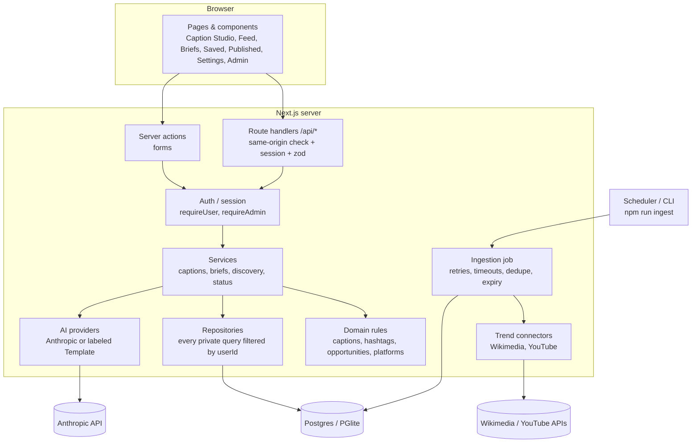

# TrendSaathi — Project Overview

**Sahi trend. Apna original angle. Behtar content.**

This file covers what has been built, what comes next, and how the system is put together.

---

## 1. What has been built

TrendSaathi is a working web app for Indian creators writing in Hindi, Hinglish or English. It runs locally with no paid credentials.

| Area | What it does | Status |
|---|---|---|
| **Caption Studio** | Paste a caption or describe a video. You get three genuinely different caption options, a recommended pick with the reason, opening hooks, hashtags, search phrases, what changed, and any assumptions. Follow-ups like "Aur short karo", "Emoji hata do" and "Meri first line same rakho" stick across turns. Copy, edit, save, regenerate with a new tone, rename and delete all work. | ✅ Working |
| **Hashtag honesty** | Hashtags are a *suggestion* by default. They show as *observed* only when a stored, recent source on the same platform contains them, and *demo* examples are labeled. The AI is never asked whether a tag is trending. | ✅ Working |
| **Ideas feed** | Filter by category, language, region, platform, search and freshness. Ideas are grouped as Timely, Worth planning and Evergreen. Each one shows its evidence, source, observation time, coverage and confidence. Rank history appears only when real, comparable observations exist. | ✅ Working |
| **Brief builder** | Turns an idea or any topic into a plan: angle, audience, hooks, opening shot, beats, call to action, titles, hashtags, facts to verify, a low-effort phone version and platform notes. Briefs can be edited. | ✅ Working |
| **Saved & Published** | Save captions, ideas and briefs. Log published post links with your own manual feedback. Your own posting pattern appears after 6 rated posts. | ✅ Working |
| **Accounts & privacy** | Email + password sign-in. Every record is private to its owner. Includes delete history, delete account, sign out everywhere, and a personalization consent toggle. | ✅ Working |
| **Demo mode** | Each visitor gets a private demo account with clearly labeled sample data. Off in production by default. | ✅ Working |
| **Admin** | Source health, run data fetches, review raw observations, turn them into ideas, aggregate AI usage. | ✅ Working |
| **Live AI (Anthropic)** | Fully implemented, with schema validation, timeouts, error handling and usage tracking. | ⚠️ Not tested against the real API (no key yet) |
| **Wikipedia pageviews (India)** | Free public source, no key needed. | ✅ Tested live: 60 observations stored |
| **YouTube Most Popular (India)** | Implemented. | ⚠️ Needs `YOUTUBE_API_KEY`; untested |
| **Instagram / TikTok / Facebook / Google Trends / trending audio** | Shown honestly as "not connected", with what each one requires. | 🚫 No permitted source yet |

### Checks run
- Lint and typecheck: clean.
- **51** unit and integration tests passing. They cover:
  - privacy between users
  - input validation
  - AI errors and timeouts
  - the AI request format
  - rate limits
  - demo vs real separation
  - the hashtag evidence rule
  - data fetching
- **6/6** browser (Playwright) tests passing on both the dev and production builds, on desktop and mobile.
- Production build: no warnings. A browser-bundle scan found no secrets.

### How the original feature notes were handled
| Request | What was built instead, and why |
|---|---|
| Hashtag "trend score" (up/down) | Real rank history from the same source only (e.g. "#14 → #6"). There's no invented score, because no permitted data supports one. |
| Best posting time | Built from the creator's own logged posts only. There's no universal "best time" claim. |
| Trending audio list | Shown as "not connected" until a licensed source exists. |
| Per-platform one-click copy | Uses sourced, configurable rules: YouTube shows up to 3 tags near the title and ignores all above 60; Instagram's 5-tag limit is unconfirmed and labeled that way. |

---

## 2. Next steps (in priority order)

1. **Turn on live AI and test it.** Add `ANTHROPIC_API_KEY` and `ANTHROPIC_MODEL` to `.env.local`. Then test the real captions (budget-phone example, every follow-up chip, Hindi Devanagari) and tune the prompts.
2. **Connect YouTube.** Add `YOUTUBE_API_KEY`, verify the chart data, and add the YouTube attribution assets its API policy requires.
3. **Enable Wikipedia data permanently.** Set `SOURCE_WIKIMEDIA_ENABLED=true` and a `WIKIMEDIA_USER_AGENT` with your real contact details. Check Wikimedia's terms for commercial use.
4. **Account basics:** email verification and password reset.
5. **Faster curation:** AI drafts idea summaries and angles from raw observations, and an admin approves each one.
6. **Full translation:** cover every UI string in Hinglish and English, and consider a Devanagari option.
7. **Deploy (when you approve):**
   - Managed Postgres (e.g. Supabase or Neon).
   - A Node host (e.g. Vercel).
   - Run `npm run db:migrate`.
   - Set up the scheduled data fetch.
8. **Later:** more languages (Tamil, Telugu, Bengali…), Instagram via Meta App Review, opt-in creator analytics, team workspaces, paid plans, licensed audio. Details are in [docs/FUTURE.md](docs/FUTURE.md).

**Waiting on you:** an Anthropic API key, a YouTube API key, and (later) Meta App Review if Instagram data is wanted.

---

## 3. Architecture

### 3.1 Stack
| Layer | Choice |
|---|---|
| Framework | Next.js 16 (App Router, Turbopack), React 19, TypeScript |
| Styling | Tailwind CSS v4 with semantic design tokens (light + dark) |
| Database | Drizzle ORM. **PGlite** (embedded Postgres) locally; **Postgres** (`DATABASE_URL`) in production. Same schema and migrations for both |
| Validation | zod 4 (request bodies, AI output, forms) |
| AI | Official Anthropic SDK, structured JSON output. The model comes from `ANTHROPIC_MODEL` |
| Auth | First-party email + password (scrypt hashing), database sessions, httpOnly cookie |
| Tests | Vitest (in-memory Postgres) + Playwright (browser) |

### 3.2 System diagram



### 3.3 Folder map
```
src/
  app/                    Pages, layouts, route handlers, server actions
    page.tsx              Landing
    signin/ onboarding/   Auth + preferences
    app/                  Signed-in app (home, caption-studio, opportunities, briefs, saved, published, settings)
    admin/                Admin + curation (server-side admin check)
    api/                  captions/turn, conversations, variants, jobs/ingest
    actions/              Server actions (auth, profile, work, admin)
  components/             UI primitives (ui.tsx), copy button, shared cards
  lib/
    config.ts             All env parsing; demo vs live decisions in one place
    db/                   Drizzle schema + client (PGlite or Postgres)
    auth/                 Password hashing, sessions
    domain/               Pure business rules (no I/O): captions, hashtags, briefs, opportunities, platforms, options
    providers/ai/         Caption & brief providers: Anthropic, Template, prompts
    providers/trends/     Source catalog + Wikimedia + YouTube connectors
    repo/                 Data access: creator, studio, work, discovery
    services/             Orchestration: captions, briefs, discovery, status
    jobs/ingest.ts        Ingestion runner
    demo/                 Demo fixtures + seeding
    security/rate-limit.ts  Postgres-backed limits & quotas
drizzle/                  SQL migrations
scripts/                  ingest, migrate, seed-demo, check-bundle, purge-filtered
tests/                    Vitest suites
e2e/                      Playwright journey tests
```

### 3.4 How one Caption Studio message flows
1. The browser sends `POST /api/captions/turn` with the message and caption settings.
2. The route handler checks same-origin, reads identity **from the session cookie only**, and validates the body with zod.
3. The service loads the conversation, scoped to the owner, and merges the settings. Follow-up phrases ("emoji hata do"…) are turned into sticky constraints.
4. The per-minute and per-day AI quota is checked in Postgres.
5. The provider runs:
   - **Anthropic** when the key and model are set: structured JSON output, then strict zod validation.
   - Otherwise a **Template preview** that is clearly labeled.
   - A failure returns a recoverable error with Retry. The app never silently swaps in the template.
6. Constraints are enforced in code: emoji removed, first line locked, kept terms checked.
7. Both messages are saved, and usage plus an event (IDs only, no caption text) are recorded.
8. Hashtag status is computed **at read time** from stored evidence: suggested / observed / demo.

### 3.5 Data model (main tables)
| Group | Tables |
|---|---|
| Identity | `users`, `sessions`, `creator_profiles`, `consents` |
| Evidence | `sources`, `ingestion_runs`, `source_observations` (with `observed_at`, `retrieved_at`, `geo`, `coverage_note`, `expires_at`, `is_demo`) |
| Ideas | `opportunities`, `opportunity_evidence` |
| Studio | `conversations`, `messages`, `caption_variants` |
| Work | `briefs`, `saved_items`, `published_posts` (manual metrics only), `feedback` |
| Operations | `events`, `usage_records`, `rate_limits` |

### 3.6 Honesty & safety rules built into the architecture
- **Demo vs real:** demo rows carry `is_demo` and never appear in a real user's feed. Production disables demo unless two flags are set.
- **No fake numbers:** confidence, freshness and momentum are computed only from stored observations. Unknown values stay unknown.
- **Privacy:** every private query takes `userId`. Admin pages show aggregates only, never caption text.
- **Security:**
  - AI keys stay server-side; a scan confirms none reach the browser bundle.
  - Pasted text is treated as data, not instructions.
  - Model output is rendered as plain text.
  - Cross-site requests are blocked.
  - The ingest endpoint requires a Bearer secret.
- **Source policies:** no scraping. YouTube data expires after 30 days. Wikipedia data is labeled as reading interest, not social popularity.

---

## 4. Quick commands
```bash
npm install && cp .env.example .env.local
npm run dev                 # http://localhost:3000
npm test                    # unit + integration tests
npm run test:e2e            # browser tests
npm run build && npm run check:bundle
npm run ingest              # fetch trend data (see README for modes)
```

More detail: [README.md](README.md) (setup, env vars, deployment) · [PROGRESS.md](PROGRESS.md) (build log) · [docs/FUTURE.md](docs/FUTURE.md) (roadmap).
